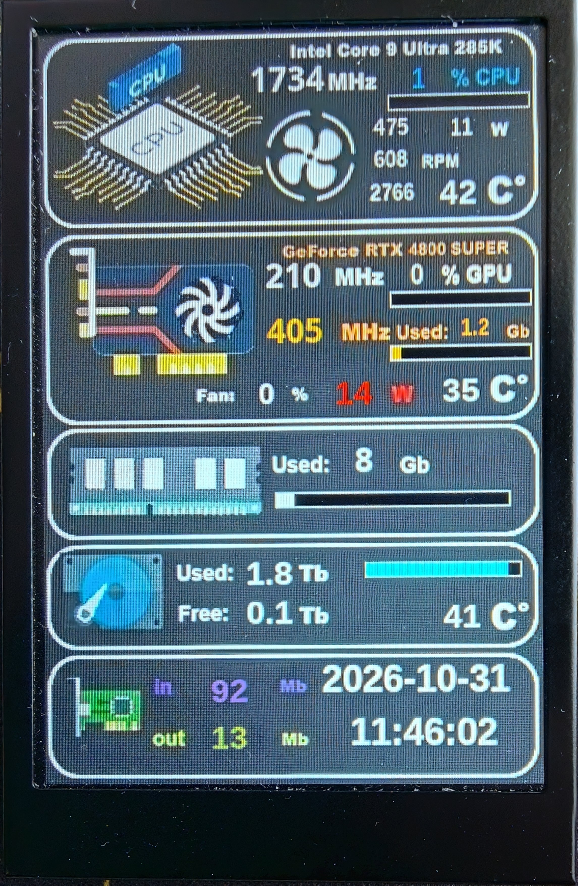
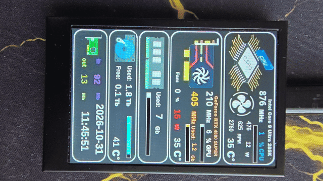

# 🖥️ Кастомный аппаратный монитор для 3.5-дюймового SmartMonitor LCD

Программно-аппаратный комплекс для вывода телеметрии компонентов ПК в реальном времени на внешнюю 3.5-дюймовую IPS/LCD панель (SmartMonitor), подключаемую по USB HID.

Проект собирает данные с аппаратных датчиков (процессор, видеокарта, оперативная память, накопители, сеть), форматирует их и отправляет на дисплей, где они визуализируются с помощью кастомного интерфейса (прогресс-бары, иконки, цветовая индикация).


*Пример статичного интерфейса на дисплее 320x480*


*Пример обновления данных в реальном времени*

---

## ⚙️ Основные возможности

Система отслеживает и отображает следующие метрики:
* 🧠 **Процессор (CPU):** Температура (Package), частота (Core Clock), общая загрузка (%), потребляемая мощность (Package Power), обороты вентиляторов (CPU, Case, Water Pump).
* 🎮 **Видеокарта (GPU):** Температура чипа, частота ядра и памяти, загрузка ядра и видеопамяти (%), потребляемая мощность, обороты вентилятора, объем использованной/выделенной памяти.
* 💾 **Память и Накопители:** 
  * **RAM:** Загружено (ГБ), общий объем, процент загрузки.
  * **Disk (NVMe):** Температура, занято/свободно (ГБ), процент нагрузки (I/O).
* 🌐 **Сеть:** Скорость загрузки (Download) и отдачи (Upload) по активному интерфейсу.
* 🕒 **Система:** Текущая дата и время.

---

## 🏗️ Архитектура проекта

Проект состоит из нескольких ключевых компонентов:

1. **`monitor.py`** (Оркестратор): Главный скрипт, работающий в бесконечном цикле (обновление ~1 сек). Определяет ОС, подключает соответствующий модуль сбора данных, форматирует значения (защита от переполнения 16-битных значений через деление на 1024), упаковывает данные в бинарные пакеты и отправляет их через `SmartMonitorHid`.
2. **`sources/hw_lin.py`** (Linux-сборщик): Нативный модуль для Linux. Читает данные напрямую из виртуальных файловых систем `/proc` и `/sys` (hwmon, nvme, cpufreq), а также использует `nvidia-smi` для GPU.
3. **`sources/hw_win.py`** (Windows-сборщик): Модуль для Windows, который опрашивает локальный веб-сервер LibreHardwareMonitor.
4. **`hw_monitor.xml`**: Файл разметки интерфейса для дисплея (разрешение **320x480**). Описывает расположение виджетов, шрифты, цвета и привязку к конкретным `fastSensor ID`.

---

## 📦 Требования

### Аппаратные
* 3.5-дюймовый SmartMonitor дисплей (поддерживающий HID-протокол и загрузку XML-конфигов).
* ПК с процессором и видеокартой (по умолчанию UI настроен под Intel Core Ultra 9 285K и NVIDIA RTX 4080 SUPER, но легко адаптируется).

### Программные
* **Python 3.10+**
* Драйверы NVIDIA и утилита `nvidia-smi` (для мониторинга GPU в Linux).

---

## 🚀 Установка и Использование

### Шаг 1. Прошивка интерфейса на дисплей
Перед первым запуском необходимо загрузить XML-конфигурацию (`hw_monitor.xml`) и графические ресурсы (фон, иконки) во внутреннюю память дисплея:
```bash
python3 flash_dat.py
```
> ⚠️ Убедитесь, что дисплей подключён по USB. После прошивки на экране должна появиться статичная картинка-заготовка из `BACK.jpg`.

---

### Шаг 2. Настройка для Linux (Рекомендуемый способ)

Для автоматической настройки прав доступа и запуска в фоне используйте встроенный скрипт установки. Он скопирует файлы в `/opt/hw_monitor`, настроит `udev` и создаст `systemd` службу.

1. Сделайте скрипт исполняемым и запустите его от имени `root`:
   ```bash
   chmod +x install.sh
   sudo ./install.sh
   ```
   *Что делает скрипт:*
   * Копирует `monitor.py`, папки `sources` и `smartmonitor` в `/opt/hw_monitor`.
   * Копирует `./linux/99-powercap.rules` и `./linux/99-smartmonitor.rules` в `/etc/udev/rules.d/`.
   * Перезагружает правила: `sudo udevadm control --reload-rules` и применяет их через `trigger`.
   * Устанавливает и активирует службу `hw_monitor.service`.

2. Управление службой:
   ```bash
   # Проверить статус
   sudo systemctl status hw_monitor
   
   # Просмотр логов в реальном времени
   sudo journalctl -u hw_monitor -f
   
   # Перезапуск после изменения кода
   sudo systemctl restart hw_monitor
   ```

*(Ручной запуск без службы)*: Если вы хотите запускать вручную, убедитесь, что применили правила `udev` (см. выше), и запустите:
```bash
python3 monitor.py
```

---

### Шаг 2. Настройка для Windows

Поскольку прямой доступ к датчикам в Windows ограничен, проект использует **LibreHardwareMonitor** в качестве источника данных.

1. Скачайте последнюю версию [LibreHardwareMonitor с GitHub Releases](https://github.com/LibreHardwareMonitor/LibreHardwareMonitor/releases).
2. Распакуйте архив и запустите `LibreHardwareMonitor.exe` **от имени администратора** *(критически важно для доступа к датчикам напряжения и энергопотребления)*.
3. Откройте настройки: Правая кнопка мыши на любом датчике → **Options** → **Settings**.
4. В разделе **Remote Web Server** установите галочку **Start Remote Web Server**.
   * *По умолчанию сервер работает на порту `8085` (`http://localhost:8085/data.json`).*
5. Рекомендуется включить **Start Minimized** и **Minimize to Tray**.
6. Оставьте программу работающей в фоне и запустите монитор:
   ```cmd
   python monitor.py
   ```
> ⚠️ Если вы измените порт в настройках LHM, обновите переменную `LHM_PORT` в файле `sources/hw_win.py`.

---

## 🛠️ Разработка

### Зависимости
Для локальной разработки создайте виртуальное окружение и установите зависимости:

```bash
python3 -m venv .venv
source .venv/bin/activate  # Для Windows: .venv\Scripts\activate
pip install -r requirements.txt
```

**Пример `requirements.txt`:**
```txt
# Обработка изображений (фон, иконки)
Pillow>=10.0.0

# Низкоуровневый доступ к HID-устройствам
hidapi>=0.14.0

# Библиотека для работы с дисплеем SmartMonitor
# Если пакет локальный, установите его вручную: pip install ./libs/smartmonitor
smartmonitor>=1.0.0
```

### Как добавить новый виджет на дисплей
Чтобы вывести новый параметр, выполните 4 простых шага:
1. **`sources/tags.py`**: Добавьте новую запись в словарь `TAGS` с уникальным `fastSensor ID`.
2. **`sources/hw_lin.py`** (или `hw_win.py`): Допишите парсер, который будет заполнять соответствующий ключ в словаре `result` функции `fetch()`.
3. **`hw_monitor.xml`**: Добавьте новый `<widget>` с нужным `fastSensor`, указав координаты (`<x>`, `<y>`), размеры, шрифт и цвет.
4. Перепрошите дисплей через `python3 flash_dat.py`, чтобы обновить конфигурацию в памяти устройства.
